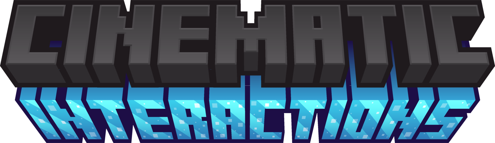

<p align="center">
  
</p>

<p align="center"><strong>Put your hands to work.</strong><br>First-person workstation scenes for Minecraft.</p>

<p align="center">
  <a href="https://github.com/dcvke/CinematicInteractions/releases"></a>
  <a href="https://github.com/dcvke/CinematicInteractions/wiki"></a>
  <a href="https://github.com/dcvke/CinematicInteractions/issues/new/choose"></a>
  <a href="LICENSE"></a>
</p>

## 🎬 Your workshop, in motion

Place ingredients on the crafting table, load a furnace by hand, and forge equipment with a hammer. Cinematic Interactions turns supported workstations into scenes you operate directly in the world, with your own skin on the animated arms and smooth camera movement.


## ✨ What you can do

- **Craft on the tabletop.** Ingredients stay on the table. Search the recipe guide, preview missing materials, and let your hands lay out the materials you have.
- **Work with your hands.** Forge, grind, cut stone, weave banners, brew potions, and enchant equipment through dedicated station animations.
- **Stay in the workshop.** Switch to a neighboring station without a full exit; return quickly to a station you just used.
- **Take a quiet moment.** Read books with animated page turns, insert music discs, or sit beside a campfire.
- **Make it comfortable.** Choose scenes per block and adjust camera lean, zoom, transition speed, hints, shake, flashes, and cinematic bars.
- **Shape your own workshop.** Developer Mode lets you adjust item positions and interaction areas in supported workstation scenes, then save local layout profiles.


[Watch the station transition video](https://dcvke.github.io/cinematic-media/showcase-station-transition.html) · [View all showcase media](https://dcvke.github.io/cinematic-media/)

## 🧩 Supported stations

| Activity | Blocks |
| --- | --- |
| Crafting & smelting | Crafting table, furnace, smoker, blast furnace, crafter |
| Tools & equipment | Anvil, grindstone, smithing table, stonecutter |
| Enchanting & brewing | Enchanting table, brewing stand |
| Banners & maps | Loom, cartography table |
| Books & music | Lectern, chiseled bookshelf, jukebox |
| Rest & effects | Campfire, soul campfire, beacon |

Chests, barrels, and shulker boxes keep their normal interfaces. [Station guide →](docs/wiki/Stations.md)

## 📦 Get the right build

For the complete shared experience, **install the mod on both the client and the server**. Recent builds also have an optional client-only preview for selected stations on servers without the mod; enable it in the main-menu settings. In singleplayer, the integrated server is handled automatically. Each Minecraft version has its own JAR: install one matching your game version and loader.

### Fabric

| Minecraft | Release |
| --- | --- |
| 1.21 | [Download](https://github.com/dcvke/CinematicInteractions/releases/tag/v0.1-fabric-1.21) |
| 1.21.1 | [Download](https://github.com/dcvke/CinematicInteractions/releases/tag/v0.1-fabric-1.21.1) |
| 1.21.2 | [Download](https://github.com/dcvke/CinematicInteractions/releases/tag/v0.1-fabric-1.21.2) |
| 1.21.3 | [Download](https://github.com/dcvke/CinematicInteractions/releases/tag/v0.1-fabric-1.21.3) |
| 1.21.4 | [Download](https://github.com/dcvke/CinematicInteractions/releases/tag/v0.1-fabric-1.21.4) |
| 1.21.5 | [Download](https://github.com/dcvke/CinematicInteractions/releases/tag/v0.1-fabric-1.21.5) |
| 1.21.6 | [Download](https://github.com/dcvke/CinematicInteractions/releases/tag/v0.1-fabric-1.21.6) |
| 1.21.7 | [Download](https://github.com/dcvke/CinematicInteractions/releases/tag/v0.1-fabric-1.21.7) |
| 1.21.8 | [Download](https://github.com/dcvke/CinematicInteractions/releases/tag/v0.1-fabric-1.21.8) |
| 1.21.9 | [Download](https://github.com/dcvke/CinematicInteractions/releases/tag/v0.1-fabric-1.21.9) |
| 1.21.10 | [Download](https://github.com/dcvke/CinematicInteractions/releases/tag/v0.1-fabric-1.21.10) |
| 1.21.11 | [**0.18.6 beta**](https://github.com/dcvke/CinematicInteractions/releases/tag/beta-2026-10-19) · [0.1](https://github.com/dcvke/CinematicInteractions/releases/tag/v0.1-fabric-1.21.11) |
| 26.1.1 | [**0.18.7 beta**](https://github.com/dcvke/CinematicInteractions/releases/tag/beta-2026-10-19) |
| 26.1.2 | [**0.18.7 beta**](https://github.com/dcvke/CinematicInteractions/releases/tag/beta-2026-10-19) |
| 26.2 | [**0.18.7 beta**](https://github.com/dcvke/CinematicInteractions/releases/tag/beta-2026-10-19) |
| 26.3 | [**0.18.7 beta**](https://github.com/dcvke/CinematicInteractions/releases/tag/beta-2026-10-19) |

Fabric API is required. Mod Menu and Cloth Config are optional settings integrations.

### NeoForge

| Minecraft | Release |
| --- | --- |
| 1.21.1 | [**0.18.12 API preview**](https://github.com/dcvke/CinematicInteractions/releases/tag/v0.18.12-neoforge-1.21.1) · [0.18.6 beta](https://github.com/dcvke/CinematicInteractions/releases/tag/beta-2026-10-19) |

Cloth Config is optional. See [installation and dependencies](docs/wiki/Installation.md) for loader requirements.

## 🎮 Start playing

1. Right-click a supported station with room to stand beside it.
2. Use the inventory panel to pick items and interact with the highlighted areas.
3. Press **Esc**, your inventory key, or a movement key to leave the scene.

Press **H** while looking at a campfire to sit down. Hold **Left Alt** during a scene for an orbit view of your character. Both bindings can be changed in Minecraft's controls.

[Controls](docs/wiki/Controls.md) · [Settings](docs/wiki/Settings.md) · [Troubleshooting](docs/wiki/Troubleshooting.md)

## 🔧 Create an add-on

Mod authors can add a Cinematic Interactions scene to their own menu-backed workstation on **NeoForge 1.21.1**. The block's menu still handles its items, recipes and rewards; Cinematic Interactions handles the approach, camera, hands and exit. Start with the [add-on API guide](docs/addon-api.md) and [source example](examples/addon-template/). The API is included in the mod JAR, so players only need Cinematic Interactions and the add-on itself.

## 🛠️ Build & explore

The root project targets **NeoForge 1.21.1**. The [`fabric/`](fabric/) project contains the Fabric ports for **1.21–1.21.11**, using version-specific source layers and shared resources. Separate projects for [`26.1.1`](fabric/26.1.1/), [`26.1.2`](fabric/26.1.2/), [`26.2`](fabric/26.2/), and [`26.3`](fabric/26.3/) contain the current feature set. The root project and 1.21.x ports require **JDK 21**; the 26.x ports require **JDK 25**. Gradle wrappers are included.

```sh
# NeoForge, from the repository root
./gradlew build

# Fabric 1.21.11, from fabric/
./gradlew -Pmc_version=1.21.11 build

# Fabric 26.2 or 26.3, from its own directory
./gradlew build
```

On Windows, use `gradlew.bat`. Read the [developer guide](docs/wiki/Development.md), [Fabric build guide](fabric/README.md), and [test coverage](fabric/TESTING.md) before changing version-specific code.

## 🗺️ Roadmap

See what is already available and what may come next in the **[interactive roadmap checklist](https://github.com/dcvke/CinematicInteractions/issues/1)**. It covers released features, further testing, and ideas under consideration. Future ideas have no fixed release dates.

[How to follow and update the roadmap →](docs/wiki/Roadmap.md)

## 🤝 Help improve the mod

Found a problem? [Open a bug report](https://github.com/dcvke/CinematicInteractions/issues/new?template=bug_report.yml) with the Minecraft version, loader, mod version, and steps to reproduce it. Screenshots or short recordings are especially useful for camera and animation issues. English and Russian reports are welcome.

Have an idea? [Suggest a feature](https://github.com/dcvke/CinematicInteractions/issues/new?template=feature_request.yml). Code contributions are welcome too: see [CONTRIBUTING.md](CONTRIBUTING.md).

## 📜 Credits & license

Created and maintained by **[Southware](https://github.com/dcvke)** as a solo project. Original project code is available under the [MIT License](LICENSE). The imported **Just a Hammer** model by **RDiamonds** is licensed under **CC BY 4.0**; attribution and adaptation details are in [CREDITS.md](CREDITS.md).

Minecraft is a trademark of Mojang Studios. This project is not an official Minecraft product and is not approved by or associated with Mojang or Microsoft.
